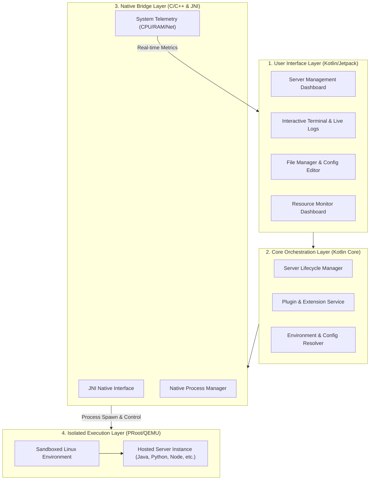
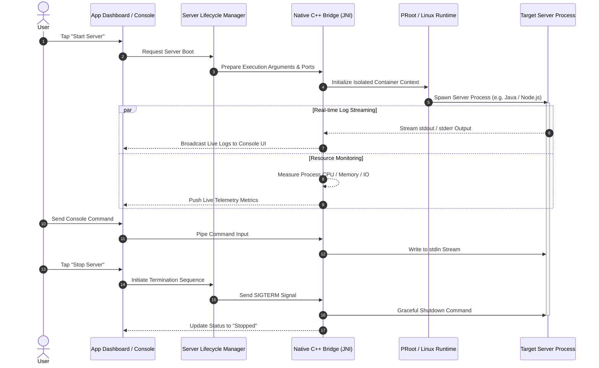

# PocketHost — Mobile Server Management & Hosting Platform

PocketHost is a versatile Android platform designed to host, execute, and manage local and dedicated servers directly on mobile devices. It turns Android hardware into a flexible hosting environment capable of running isolated Linux environments, custom backend services, scripts, and gaming servers.

---

## 🎯 Purpose & Key Features

The primary goal of PocketHost is to enable convenient, isolated, and efficient self-hosting on mobile hardware without requiring root access.

### Core Capabilities
- **Server Manager**: Create, configure, launch, and monitor custom server instances (TCP/UDP, Linux services, Node.js, Python, or Java runtimes).
- **Sandboxed Runtimes**: Execute Linux distributions and server binaries inside isolated PRoot or QEMU user-space containers.
- **Real-Time Monitoring**: Track CPU consumption, memory allocation, active network ports, and process health via high-performance native engines.
- **Integrated File Management**: Manage server directories, edit configuration files, and create system backups directly within the app.
- **Modular Plugin System**: Extensible architecture supporting dedicated plugins (e.g., Minecraft server manager supporting Vanilla, Paper, Spigot, Fabric, Forge, etc.).

---

## 🔄 Architecture & Principle of Operation

PocketHost orchestrates the complete lifecycle of hosted servers and Linux environments through four primary architecture layers: the User Interface layer, the Core Orchestration layer, the Native Execution Bridge, and the Sandboxed Container layer.

### Architecture Overview



### Execution & Control Workflow

When managing server lifecycles, PocketHost executes an asynchronous pipeline linking native Android background services with the sandboxed Linux runtime:



---

### Key Operational Principles

1. **Sandboxed User-Space Execution**:
   PocketHost utilizes **PRoot** and **QEMU** technologies to bind mount points and intercept system calls, enabling full Linux file systems and server binaries to run without root privileges or device modification.

2. **Native Performance Telemetry**:
   Resource statistics (CPU percentage, memory RSS/VSZ, network socket states) are gathered directly by a dedicated **C/C++ native layer** querying Linux system interfaces (`/proc`), keeping overhead low.

3. **Asynchronous I/O & Terminal Pipe**:
   Process input and output streams are piped via non-blocking POSIX channels connected to background Android services, providing real-time logging without blocking the user interface.

---

## 📁 Project Structure

```text
PocketHost/
├── app/                  # Main Android application module (UI, Services, ViewModels)
│   ├── src/main/java/    # Application Kotlin source code
│   └── src/main/res/     # Resources, layouts, and strings
├── core/                 # Shared domain logic, repositories, and data models
├── native/               # High-performance C/C++ engine layer
│   ├── src/main/cpp/     # Process management, system monitor, PRoot hooks
│   └── CMakeLists.txt    # CMake compilation config for NDK
└── plugins/              # Extensible modules (e.g., Minecraft Server manager)
```

---

## 🚀 Getting Started

### Prerequisites for Building
- **Android Studio**: Ladybug (or newer recommended)
- **Java Development Kit (JDK)**: Version 17+
- **Android SDK**: API Level 26+ (Android 8.0 Oreo minimum)
- **Android NDK & CMake**: 3.22.1+ (for compiling native C++ binaries)
- **Gradle**: 8.x+

### Building the Application

1. Clone the repository:
   ```bash
   git clone https://github.com/your-username/PocketHost.git
   cd PocketHost
   ```

2. Open the project in **Android Studio**.

3. Build the APK using the Gradle wrapper:
   ```bash
   ./gradlew assembleDebug
   ```

---

## ⚙️ Usage Guide

1. **Launch PocketHost**: Open the app on your mobile device.
2. **Add a Server**:
   - Tap **"+"** to create a server instance.
   - Choose a template or container type (Custom Linux container, Minecraft server, Python environment, etc.).
   - Define network ports, memory constraints, and start parameters.
3. **Control & Interact**:
   - Tap **Start** to initialize the server process.
   - Access the **Console** tab to read live logs and execute commands via standard input.
   - Access the **File Manager** to upload, download, or tweak configuration files.

---

## 🔒 Security & Sandbox Assurance

- **Non-Root Operation**: Operates entirely within standard Android user app sandboxes.
- **Local Data Isolation**: All server files, databases, and logs are kept strictly within local storage.
- **Port Isolation**: Network operations bind to designated non-privileged local ports.

---

## 📄 License

This project is provided under the MIT License. See the `LICENSE` file for full licensing information.
