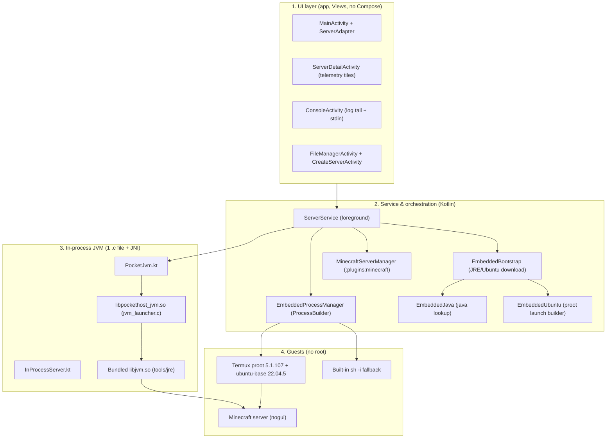
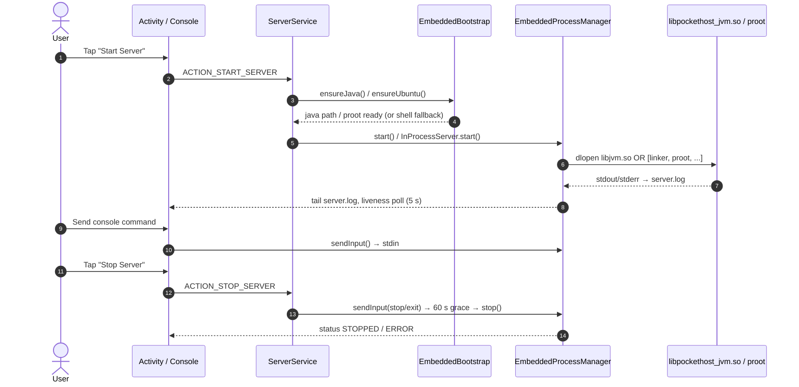

# PocketHost — Mobile Server Management & Hosting Platform

PocketHost is an Android platform for hosting and managing game and Linux servers directly on the device, without root and without an external Termux app. It runs Minecraft servers in an in-process JVM and Ubuntu 22.04 userland via PRoot, all inside the app's private storage.

GitHub: `https://github.com/W1zago/PocketHost`

---

## 🎯 Purpose & Key Features

The goal is convenient, isolated self-hosting on mobile hardware without root access.

### What the app actually does today

- **Two server types** (`ServerType` in `core/src/main/java/com/pockethost/core/model/Server.kt`):
  - `MINECRAFT` — Paper / Vanilla / Purpur / Fabric jars download automatically via `:plugins:minecraft`. Spigot / Forge / NeoForge / Bukkit have no direct download (BuildTools/installer required) — drop the jar manually via Files (`spigot.jar` / `forge.jar` / `neoforge.jar` / `craftbukkit.jar`) after creation.
  - `UBUNTU_SERVER` — full Ubuntu 22.04 rootfs via PRoot, with fallback to the built-in `sh -i` shell when Ubuntu is not installed.
- **In-process JVM** (`app/src/main/cpp/jvm_launcher.c` → `libpockethost_jvm.so`, Kotlin layer `app/.../jvm/PocketJvm.kt` + `InProcessServer.kt`, ported from MojoLauncher/PojavLauncher): headless server launch via `dlopen libjvm.so`, no `exec` — this bypasses the Android 10+ W^X `error=13` ban on executing binaries from the app dir.
- **Bundled runtimes, downloaded on demand** (`app/.../embedded/EmbeddedBootstrap.kt`):
  - JRE 17 (~40 MB, Pojav Bionic build) auto-downloaded on first Minecraft start. Minecraft 1.20.5+ needs Java 21 — no stable auto-download, import JRE 21 manually into `tools/jre21/` via Files.
  - Ubuntu 22.04.5 rootfs (~27 MB archive, ~150 MB unpacked) + Termux `proot` `.deb`s, auto-downloaded on Ubuntu start.
  - First-start essential packages (`sudo, git, curl, python3, nodejs, openssh-*, ...`) install in background after the console is live.
- **Built-in terminal, no external Termux** (`app/.../embedded/EmbeddedProcessManager.kt` + foreground `app/.../service/ServerService.kt`): plain `ProcessBuilder` in the app UID, stdin via console, stdout/stderr tailed from `server.log`. Legacy `TermuxBridge` is kept only as `@Deprecated` delegating to the embedded manager.
- **Console, files, telemetry (Kotlin, no native monitor)**: live log tail (`ConsoleActivity`), file manager + config editor (`FileManagerActivity`), device/JVM-heap tiles in `ServerDetailActivity` (2 s poll via Android APIs). There is no C++ `/proc` telemetry engine.
- **Desktop counterpart** (`jvm-host/` module): pure-JVM mirror of the Ubuntu flow for PCs (WSL2 on Windows, system `proot` on Linux, host shell fallback) + HTTP LAN bridge so the phone console can reach the PC. See `jvm-host/README.md`.

### Hard limits (by design, not bugs)

- Max **2** concurrent servers (`EmbeddedProcessManager.MAX_SERVERS`).
- **1 in-process JVM per app process**: a second Minecraft server with a different classpath refuses honestly with "Stop the other server first" instead of dying deep in native code.
- Supported ABIs: `arm64-v8a`, `armeabi-v7a`, `x86_64`. Ubuntu rootfs exists upstream only for `arm64 / armhf / amd64` — other arches get the built-in shell only.

---

## 🔄 Architecture & Principle of Operation

Three Kotlin layers + one small native file. There is no QEMU, no `native/` top-level module, no `PluginManager / ConfigResolver / ProcController / SysMonitor` — those names do not exist in the codebase.

### Architecture Overview



### Execution & Control Workflow



### Key Operational Principles

1. **No exec from the app dir (W^X)**: Android 10+ with `targetSdk 29+` denies `execve()` in `filesDir` (`error=13`). Minecraft therefore runs **in-process** (`dlopen libjvm.so + JNI_CreateJavaVM`); PRoot/JRE binaries run **via the system linker** (`/system/bin/linker64 ...`). Legacy direct exec remains only as a fallback.
2. **PRoot, not QEMU**: Ubuntu is `ubuntu-base 22.04.5` from `cdimage.ubuntu.com` + Termux `proot 5.1.107` / `libtalloc` / `libandroid-shmem` `.deb`s, with `PROOT_TMPDIR / PROOT_LOADER(_32) / PROOT_NO_SECCOMP=1` overrides and guest fixups (resolv.conf, `/root/server` bind-mount of the server folder). QEMU is not used anywhere.
3. **Honest failure over silent death**: busy port, broken/truncated jar, missing `Main-Class`, Java too old, missing Ubuntu — all refuse with a reason in `server.log` and `ERROR` status instead of hanging in `RUNNING`.
4. **JVM exits are trapped**: `System.exit()` from the server is caught via `setjmp/longjmp` in `jvm_launcher.c` so it parks instead of killing the whole app process.

---

## 📁 Project Structure

```text
PocketHost/
├── app/                        # Android app (UI, ServerService, embedded, JVM, native)
│   ├── src/main/java/com/pockethost/app/
│   │   ├── ui/                 # MainActivity, ServerDetailActivity, ConsoleActivity,
│   │   │                       # FileManagerActivity, CreateServerActivity, adapters
│   │   ├── service/            # ServerService (foreground lifecycle)
│   │   ├── embedded/           # EmbeddedBootstrap, EmbeddedJava, EmbeddedUbuntu,
│   │   │                       # EmbeddedProcessManager, EmbeddedPaths, Tar/Deb extractors
│   │   ├── jvm/                # PocketJvm.kt, InProcessServer.kt (JNI Kotlin layer)
│   │   ├── termux/             # Legacy Termux* helpers; TermuxBridge is @Deprecated
│   │   └── util/               # MinecraftProvisioner, ServerProperties, MotdGenerator, ...
│   ├── src/main/cpp/           # jvm_launcher.c + CMakeLists.txt (libpockethost_jvm.so)
│   ├── src/main/jniLibs/<abi>/ # packaged libproot_loader.so (exec-safe proot trampoline)
│   └── build.gradle.kts        # compileSdk/targetSdk 34, minSdk 26, ABIs, 16KB page flag
├── core/                       # :core Android library — Server/ServerConfig/ServerType,
│                               # ServerRepository, JavaUtils, FileUtils, NetworkUtils
├── plugins/minecraft/          # :plugins:minecraft — MinecraftServerManager
│                               # (Paper/Vanilla/Purpur/Fabric auto-download; Spigot/Forge/NeoForge/Bukkit manual)
├── jvm-host/                   # :jvm-host pure-JVM desktop mirror (no Android APIs):
│                               # UbuntuServer, BridgeServer (LAN :8765), LocalProcessManager
└── BUILD.md / JAVA_SETUP.md / jvm-host/README.md   # build, JRE setup, desktop module docs
```

Module graph: `:app` depends on `:core` + `:plugins:minecraft`; `:jvm-host` is standalone (`:jvm-host:build/run/test`).

---

## 🚀 Getting Started

### Prerequisites for Building

- **Android Studio**: Ladybug / Koala / Jellyfish or newer (Gradle 8.13 support required)
- **JDK**: 17 (Eclipse Adoptium / Temurin 17; `JAVA_HOME` → JDK 17, Gradle JDK → JDK 17)
- **Android SDK**: `compileSdk` 34 / `targetSdk` 34 / `minSdk` 26
- **Android NDK**: 25.0+ side-by-side + **CMake 3.22.1** (compiles `libpockethost_jvm.so`)
- **Gradle**: 8.13 via wrapper (`gradlew` / `gradlew.bat`)
- Stack: AGP 8.13.2, Kotlin 1.9.22 (JVM 17), Java 17 source/target; APK keeps English resources only (`resourceConfigurations += "en"`)

Full steps: [`BUILD.md`](BUILD.md). JRE provisioning details: [`JAVA_SETUP.md`](JAVA_SETUP.md). Desktop module: [`jvm-host/README.md`](jvm-host/README.md).

### Building the Application

1. Clone the repository:
   ```bash
   git clone https://github.com/W1zago/PocketHost.git
   cd PocketHost
   ```

2. Open the project in **Android Studio** (wait for Gradle sync; enable `NDK (Side by side)` + `CMake` in SDK Tools).

3. Build the APK:
   ```bash
   ./gradlew assembleDebug        # Linux / macOS
   .\gradlew.bat assembleDebug    # Windows
   ```
   Output: `app/build/outputs/apk/debug/app-debug.apk`. CMake bundles `libpockethost_jvm.so` (with `-z,max-page-size=16384` for Android 15+ 16 KB pages) automatically.

4. Desktop mirror (no Android SDK needed):
   ```bash
   ./gradlew :jvm-host:build
   ./gradlew :jvm-host:run --args="status"
   ```

---

## ⚙️ Usage Guide

1. **Launch PocketHost** on the device (grant storage / all-files access only if you use a custom server folder outside app storage).
2. **Create a server** (`+`):
   - **Minecraft**: pick loader (Paper recommended; Vanilla/Purpur/Fabric auto-download, Spigot/Forge/NeoForge/Bukkit manual jar via Files), version (≤ 1.20.4 runs on bundled JRE 17; 1.20.5+ labelled "needs JRE 21" and needs manual JRE 21 in `tools/jre21/`), port, RAM (128–3072 MB, capped), `online-mode` (offline also turns off `enforce-secure-profile` for chat), `view-distance`. JAR (~50–100 MB, Fabric ~180 KB launcher) downloads on first start; `eula.txt` is auto-accepted and `server.properties` patched on every start (`--nojline` is always passed so console `stop` reaches stdin).
   - **Ubuntu**: starts the built-in shell immediately; full Ubuntu 22.04 (~30 MB) downloads on first start or from settings, then runs `bash --login` under PRoot with the server folder at `/root/server`. Essential packages install in background; SSH via `/usr/sbin/sshd -p 2222` after `passwd`.
3. **Control & interact**:
   - **Start/Stop** from the dashboard or detail screen (graceful `stop`/`exit` via stdin, up to 60 s grace; max 2 servers, 1 in-process Minecraft at a time).
   - **Console** tab: live `server.log` tail + stdin commands.
   - **Files** tab: browse the real server dir (internal `filesDir/servers/<id>`, external app storage, or a custom folder), edit configs, drop jars/JREs manually.
   - Detail tiles show JVM-heap/device telemetry; the log always carries the honest failure reason when a start refuses.

---

## 🔒 Security & Sandbox Assurance

- **Non-root, app sandbox**: everything lives in app-private storage (`filesDir/servers/<id>`, `filesDir/tools/`, `filesDir/ubuntu/`); no device modification.
- **User-space isolation only**: PRoot bind-mounts + in-process JVM — no real containers/VMs, no SELinux bypass; `exec` from app storage stays banned by the OS, hence the linker/in-process design.
- **Local-first**: server files, DBs and logs stay on device; the only network fetch is the on-demand JRE/Ubuntu/Minecraft-jar downloads over plain `INTERNET`. `jvm-host serve` binds `0.0.0.0:<port>` for the LAN bridge — keep it on trusted Wi-Fi.
- **Port discipline**: servers bind the configured port (default Minecraft 25565); a busy port refuses with `ERROR` instead of double-starting over a locked world.

---

## 📄 License

This project is provided under the MIT License. See the `LICENSE` file for full licensing information.
